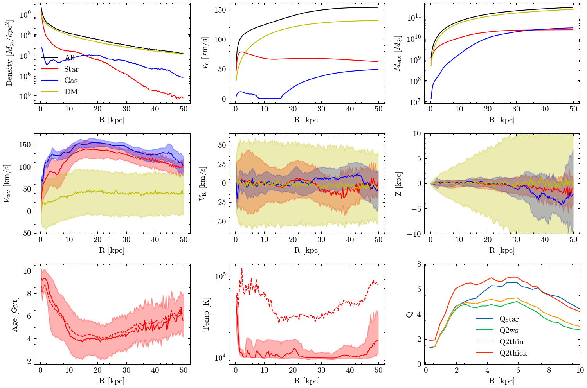
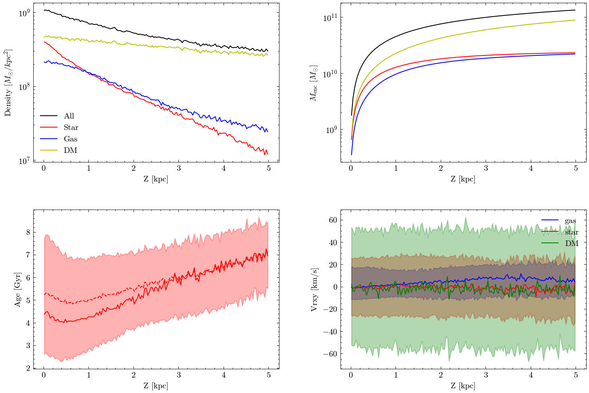

# AnastrisTNG

English · [简体中文](README_CN.md)

Analyze particles, group catalogs and SubLink merger trees from **Illustris**, **IllustrisTNG** and **TNG-Cluster** with **[pynbody](https://github.com/pynbody/pynbody)**.

## Installation

Use Python 3.8 or later.

```shell
git clone https://github.com/wx-ys/AnastrisTNG.git
cd AnastrisTNG
python -m pip install -e .
```

## Read your first subhalo

You can read a local snapshot or fetch data on demand from the public TNG API. Both use the same analysis code.

Use [your TNG API key](https://www.tng-project.org/users/profile/) to load subhalo 12 from TNG50-1 and calculate its total atomic hydrogen mass.

```python
from AnastrisTNG import Snapshot

snap = Snapshot.from_api("TNG50-1", 99, api_key="YOUR_API_KEY")
sub = snap.load_particle(12)
sub.physical_units()

spin = sub.GC["SubhaloSpin"]
print(sub.gas["mHI"].sum())
```

[See the API usage notebook](examples/AnastrisTNG_api_usage.ipynb).

For downloaded data, replace the line that opens the snapshot.

```python
snap = Snapshot("/data/TNG50-1/output", 99)
```

## Analysis examples

| [Radial profile](examples/AnastrisTNG_profile-cn.ipynb) | [Vertical profile](examples/AnastrisTNG_profile-cn.ipynb) |
| :---: | :---: |
|  |  |

**[Trace the star formation history with GalaxyPose](examples/AnastrisTNG_galpos_SFH-cn.ipynb)**

[](https://github.com/GalaxySimAnalytics/GalaxyPose/blob/main/examples/sfr_evolution.png)

### Analysis notebooks

| What you want to do | Notebook |
| --- | --- |
| Load halos, subhalos or a TNG-Cluster zoom | [Quick start](examples/AnastrisTNG_quick_start-cn.ipynb) |
| Measure galaxy properties and orient a galaxy face-on | [Galaxy properties](examples/AnastrisTNG_galaxy_func-cn.ipynb) · [Face-on views](examples/AnastrisTNG_galaxy_face_on-cn.ipynb) |
| Measure radial and vertical profiles | [Profiles](examples/AnastrisTNG_profile-cn.ipynb) |
| Follow a merger tree or trace particles across snapshots | [Merger histories](examples/AnastrisTNG_evolution_history-cn.ipynb) · [Particle tracing](examples/AnastrisTNG_trace_particles.ipynb) |
| Use optional analysis packages | [GalaxyPose star formation histories](examples/AnastrisTNG_galpos_SFH-cn.ipynb) · [pynbody-extras](examples/AnastrisTNG_pynext_example-cn.ipynb) |

---

Maintained by [Shuai Lu](https://github.com/wx-ys) under the [MIT license](LICENSE). Built on [pynbody](https://github.com/pynbody/pynbody), [illustris_python](https://github.com/illustristng/illustris_python) and [pytreegrav](https://github.com/mikegrudic/pytreegrav).
