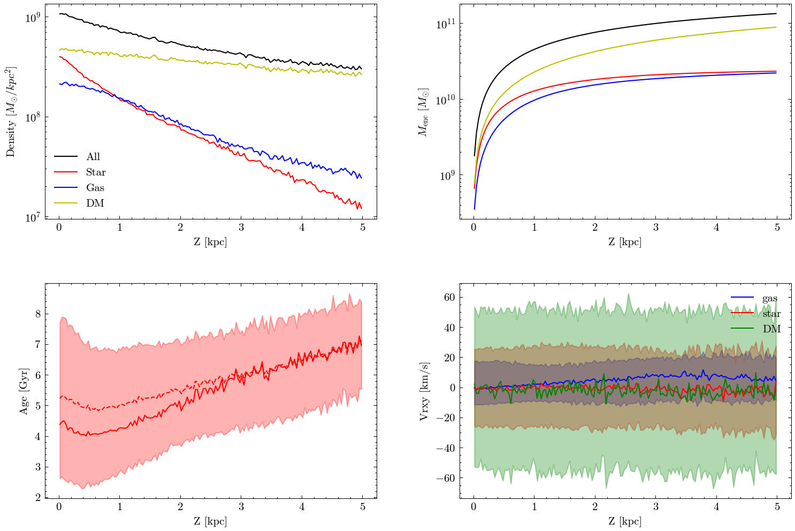
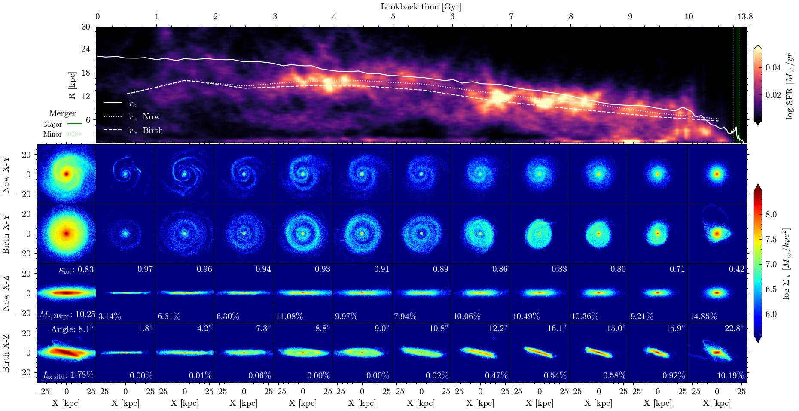

# AnastrisTNG

[English](README.md) · 简体中文

AnastrisTNG 在 pynbody 中读取 Illustris 和 IllustrisTNG 的粒子、星表和 SubLink 并合树，用于分析星系和暗物质晕。

**本地文件** — 用 `Snapshot(output_dir, snap_number)` 从本地读取已下载的快照文件和星表。分析并合历史时，还需下载对应的 SubLink 并合树。

**远程 API** — 用 `Snapshot.from_api(run, snap_number)` 直接从 TNG 服务器按需读取粒子数据、星表字段和并合历史。下载的数据会缓存在本地。登录 TNG 官网后，可在 [TNG 个人账户页面](https://www.tng-project.org/users/profile/) 获取 API key。

打开快照后，两种方式使用相同的分析接口。

| 用途 | 调用方式 |
| --- | --- |
| 读取单个 halo 或 subhalo 的粒子和星表条目 | `snap.load_particle(...)`、`sub.GC` |
| 将 subhalo 和宿主 halo 加载到同一快照 | `snap.load_subhalo(...)`、`snap.load_halo(...)` |
| 从整份星表中按列读取数据 | `snap.halos_GC(...)`、`snap.subhalos_GC(...)` |
| 查找星系主分支上的并合事件 | `snap.merger_history(...)` |
| 追踪星系或暗物质晕的演化 | `snap.galaxy_evolution(...)`、`snap.halo_evolution(...)` |
| 读取 TNG-Cluster 的完整 zoom 区域 | `snap.load_particle(..., groupType="Zoom")` |

支持 Illustris-1 至 Illustris-3、TNG50-1 至 TNG50-4、TNG100-1 至 TNG100-3、TNG300-1 至 TNG300-3，以及 TNG-Cluster。红移为零的快照编号在**原版 Illustris 中为 135**，在 **TNG 中为 99**。

## 安装

在 Python 3.8 或更新版本的环境中安装。

```shell
git clone https://github.com/wx-ys/AnastrisTNG.git
cd AnastrisTNG
python -m pip install -e .
```

## 打开快照

**本地文件。** 传入模拟的 `output` 目录，其中包含 `snapdir_099/` 和 `groups_099/`。使用 TNG 公开文件时，将对应的 offsets 文件放在 `../postprocessing/offsets/` 下。

```python
from AnastrisTNG import Snapshot

snap = Snapshot("/data/TNG50-4/output", 99)
```

**远程 API。** 设置环境变量 `TNG_API_KEY`，或在 Python 进程或 notebook 内核的工作目录中创建 `.env` 文件，写入下面一行。

```dotenv
TNG_API_KEY=your_key_here
```

```python
from AnastrisTNG import Snapshot

snap = Snapshot.from_api("TNG50-4", 99)
```

读取原版 Illustris 的零红移快照可用 `Snapshot.from_api("Illustris-3", 135)`。如果本地已有部分文件，可传入 `local_dir="/data/TNG50-4/output"`，优先使用本地数据，再从 API 获取缺失部分。

## 使用示例

### 读取 subhalo 的气体密度

```python
sub = snap.load_particle(22842)
rho = sub.gas["rho"]
sub.physical_units()
```

访问这个 subhalo 的 `rho` 会读取气体 `Density` 的对应行，缓存缺失时按需下载 HDF5 字节块。需要气体粒子 ID 时，再读取 `sub.gas["iord"]`。

### 加载 subhalo 和宿主 halo

```python
snap.load_subhalo(22842)
host_id = int(snap.subhalos[22842].GC["SubhaloGrNr"])
snap.load_halo(host_id)
rho_in_host = snap.gas["rho"][snap.gas["SubhaloID"] == 22842]
```

### 读取星表字段，追踪演化历史

```python
halo_mass = snap.halos_GC("GroupMass")
host_ids = snap.subhalos_GC("SubhaloGrNr")
host_id = int(host_ids[10])

galaxy = snap.galaxy_evolution(10, fields=["SubhaloMass"])
host = snap.halo_evolution(host_id, fields=["GroupMass"])
mergers = snap.merger_history(10, massPartType="dm", minMassRatio=0.01)
```

星系演化追踪 subhalo 10 的主分支，宿主 halo 的演化沿其中心 subhalo 的主分支追踪。可按 `SnapNum` 对齐两者的时期。

### 读取 TNG-Cluster 的完整 zoom 区域

传入所选快照中的一个 FoF halo ID，即可读取它所属的整个 zoom 区域。

```python
cluster = Snapshot.from_api("TNG-Cluster", 99)
zoom = cluster.load_particle(0, groupType="Zoom")
bh_mass = zoom.bh["mass"]
```

### 离线重开缓存数据

在线读取气体密度后，可离线重开同一模拟的同一快照。默认缓存目录是 `~/.cache/AnastrisTNG`，首次写入时自动创建。如果指定过 `cache_dir`，重开时使用相同目录即可。

```python
offline = Snapshot.from_api("TNG50-4", 99, offline=True)
rho = offline.load_particle(22842).gas["rho"]
```

Halo 和 subhalo 按官方快照偏移读取粒子，共享原始 HDF5 文件的缓存块。读取宿主时，可以复用之前读取 subhalo 缓存的数据块。星表和 SubLink 数据也可以跨会话复用。升级至 3.1.0 后，旧版逐对象 cutout、星表、计数和 SubLink 数组需要在线重新读取一次，才能用新缓存离线重开。在 `from_api` 中设置 `progress=False` 可以关闭下载进度显示。

## 分析示例

| 主题 | Notebook |
| --- | --- |
| 入门 | [快速上手](examples/AnastrisTNG_quick_start-cn.ipynb) · [星系属性](examples/AnastrisTNG_galaxy_func-cn.ipynb) |
| 结构与成像 | [星系正面投影](examples/AnastrisTNG_galaxy_face_on-cn.ipynb) · [径向与垂向剖面](examples/AnastrisTNG_profile-cn.ipynb) |
| 演化 | [并合树](examples/AnastrisTNG_evolution_history-cn.ipynb) · [粒子追踪](examples/AnastrisTNG_trace_particles.ipynb) |
| 扩展工具 | [GalaxyPose 恒星形成历史](examples/AnastrisTNG_galpos_SFH-cn.ipynb) · [pynbody-extras](examples/AnastrisTNG_pynext_example-cn.ipynb) |

 

可用 `python -m pip install galpos` 安装 GalaxyPose。有关原始恒星形成历史分析的问题，可联系 lushuai@stu.xmu.edu.cn。[GalaxyPose 项目](https://github.com/GalaxySimAnalytics/GalaxyPose)



## 测试

第一条命令在本地验证读取功能。第二条使用真实 API key，对照 Illustris-3 的公开数据验证粒子、星表和演化历史。

```shell
python -m unittest discover -s tests -p test_remote.py -k RemoteSnapshotTest -v
python -m unittest discover -s tests -p test_remote.py -k PublicArchiveValidation.test_original_illustris -v
```

## 项目信息

由 [Shuai Lu](https://github.com/wx-ys) 维护，采用 [MIT 许可证](LICENSE)。本项目基于 [pynbody](https://github.com/pynbody/pynbody)、[illustris_python](https://github.com/illustristng/illustris_python) 和 [pytreegrav](https://github.com/mikegrudic/pytreegrav)。
