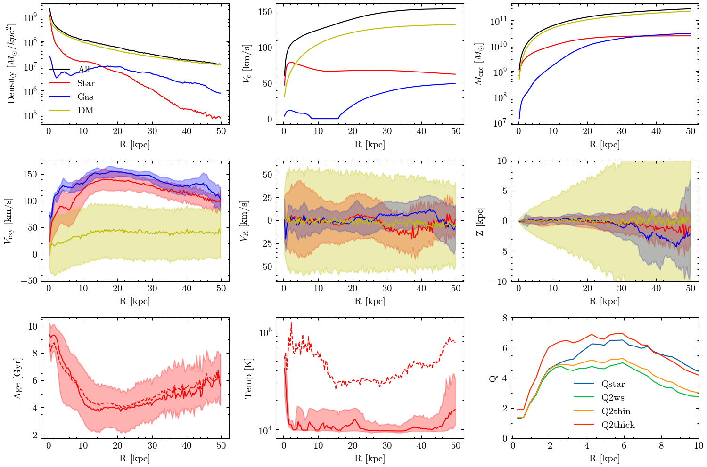

# AnastrisTNG

[English](README.md) · 简体中文

用 **[pynbody](https://github.com/pynbody/pynbody)** 分析 **Illustris**、**IllustrisTNG** 和 **TNG-Cluster** 的粒子、星表和 SubLink 并合树。

## 安装

使用 Python 3.8 或更高版本。

```shell
git clone https://github.com/wx-ys/AnastrisTNG.git
cd AnastrisTNG
python -m pip install -e .
```

## 读取第一个 subhalo

可以从本地快照读取数据，也可以通过 TNG 公共 API 按需获取数据。两种方式共用同一套分析代码。

下面通过 API 读取 TNG50-1 的 12 号 subhalo，并计算它的原子氢总质量。[获取 TNG API 密钥](https://www.tng-project.org/users/profile/)。

```python
from AnastrisTNG import Snapshot

snap = Snapshot.from_api("TNG50-1", 99, api_key="YOUR_API_KEY")
sub = snap.load_particle(12)
sub.physical_units()

spin = sub.GC["SubhaloSpin"]
print(sub.gas["mHI"].sum())
```

[查看完整 API 示例](examples/AnastrisTNG_api_usage.ipynb)。

如果已有本地数据，只需换一行打开快照。

```python
snap = Snapshot("/data/TNG50-1/output", 99)
```

## 分析示例

| [径向剖面](examples/AnastrisTNG_profile-cn.ipynb) | [垂向剖面](examples/AnastrisTNG_profile-cn.ipynb) |
| :---: | :---: |
|  |  |

**[用 GalaxyPose 分析恒星形成史](examples/AnastrisTNG_galpos_SFH-cn.ipynb)**

[](https://github.com/GalaxySimAnalytics/GalaxyPose/blob/main/examples/sfr_evolution.png)

### 示例 Notebook

| 想做什么 | Notebook |
| --- | --- |
| 加载 halo、subhalo 或 TNG-Cluster 的 zoom 区域 | [快速上手](examples/AnastrisTNG_quick_start-cn.ipynb) |
| 计算星系属性，调整星系视角 | [星系属性](examples/AnastrisTNG_galaxy_func-cn.ipynb) · [星系正面投影](examples/AnastrisTNG_galaxy_face_on-cn.ipynb) |
| 测量径向和垂向剖面 | [剖面分析](examples/AnastrisTNG_profile-cn.ipynb) |
| 追踪并合历史或跨快照追踪粒子 | [并合树](examples/AnastrisTNG_evolution_history-cn.ipynb) · [粒子追踪](examples/AnastrisTNG_trace_particles.ipynb) |
| 使用扩展分析工具 | [GalaxyPose 恒星形成历史](examples/AnastrisTNG_galpos_SFH-cn.ipynb) · [pynbody-extras](examples/AnastrisTNG_pynext_example-cn.ipynb) |

---

由 [Shuai Lu](https://github.com/wx-ys) 维护，采用 [MIT 许可证](LICENSE)。本项目基于 [pynbody](https://github.com/pynbody/pynbody)、[illustris_python](https://github.com/illustristng/illustris_python) 和 [pytreegrav](https://github.com/mikegrudic/pytreegrav)。
